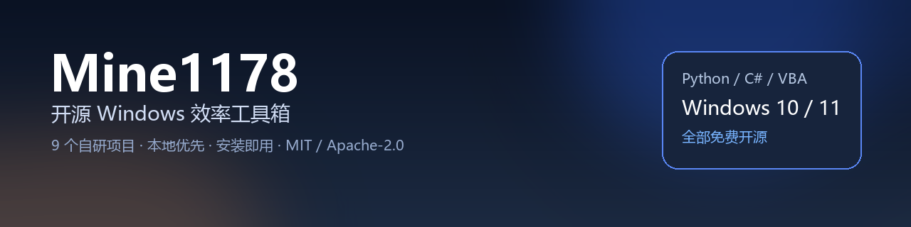

<h3>你好，我是张俊 · 通信工程师 / Windows 工具开发</h3>

把通信勘察、文档排版、办公表格、翻译和文件整理里的重复劳动，做成双击就能用的软件。

**9 个自研项目，全部免费开源；本地优先，不强制登录，不上传你的文件。**

---

## ⭐ 第一次来，先试这 3 个

<table>
<tr>
<td width="33%" align="center" valign="top">

<h3>QTranslate</h3>

选中即译的 Windows 划词翻译 多引擎 + TTS + 本地生词本

</td>
<td width="33%" align="center" valign="top">

<h3>SealMaker</h3>

圆形公司章 / 椭圆发票章 508 DPI 透明背景导出

</td>
<td width="33%" align="center" valign="top">

<h3>重命名大师</h3>

照片 / PDF / 表格批量改名 纯本地、可预览、可撤销

</td>
</tr>
</table>

> 三个都提供 Windows 安装版，下载即用，不需要配置 Python 环境。

---

## 🧰 全部项目

| 场景 | 项目 | 一句话说明 | 入口 |
| --- | --- | --- | --- |
| 看外文 / 背单词 | **QTranslate** | 划词即译，百度 / DeepL / Google / OpenAI 多引擎，Edge TTS 朗读 | [下载](https://github.com/Mine1178/QTranslate/releases/latest) |
| 做工程报告 / 合同表格 | **Word-table-beautifier** | Word / WPS 表格一键美化：外粗内细、五号宋体、表头跨页重复 | [下载](https://github.com/Mine1178/Word-table-beautifier/releases/latest) |
| 整理照片 / PDF / 资料 | **RenameMaster** | 批量规范改名 + 图片压缩，执行前预览，输出隔离可撤销 | [下载](https://github.com/Mine1178/renamemaster/releases/latest) |
| 课件 / 手账 / 发票印章 | **SealMaker** | 标准电子印章生成，毫米级排版，透明 PNG 直接插 Word | [下载](https://github.com/Mine1178/SealMaker/releases/latest) |
| 通信设计文档排版 | **redesigned-train** | 8 套模板、标题识别、批量排版、自动目录，支持 OpenAI 兼容接口 | [源码](https://github.com/Mine1178/redesigned-train) |
| 站点台账 / 地址转坐标 | **addressmap-tool** | 地址 ↔ 经纬度双向转换，高德 / 百度双引擎，Excel 批量写回 | [下载](https://github.com/Mine1178/addressmap-tool/releases/latest) |
| 通信图纸手绘化 | **hand-drawn-sketch** | 机房布局 / 光缆路由 / 天线安装图，转成现场铅笔手绘风 | [源码](https://github.com/Mine1178/hand-drawn-sketch) |
| 双 AI 协作开发 | **d2w-skill** | 豆包 ⇄ WorkBuddy 派活、写码、互审、打包、交付闭环 | [下载](https://github.com/Mine1178/d2w-skill/releases/latest) |
| 聊天话术 / 关系沟通 | **狗头军师助手** | 聊天导入、对象档案、话术库、托盘唤起，支持 OpenAI / DeepSeek | [下载](https://github.com/Mine1178/goutoujunshi-assistant/releases/latest) |

---

## 🆕 最近发布

<table>
<tr>
<td width="55%"></td>
<td valign="top">
<h3>狗头军师助手 v2.5</h3>

把聊天记录变成一条能直接发出去的话。热键唤起、对象建档、聊天导入、话术库、托盘常驻。

<strong>只粘贴，不自动发送；聊天数据只留在本机。</strong>

</td>
</tr>
</table>

---

## 🛠️ 技术栈

## 📊 GitHub 数据

  
  

---

## 💬 找到我

- **遇到 Bug / 想提需求**：到对应仓库开 [Issue](https://github.com/Mine1178?tab=repositories)
- **想要某个工具但没时间做**：开 Issue 说场景，我按需求排期
- **觉得有用**：给对应仓库点一颗 ⭐ Star，是最直接的帮助

  

